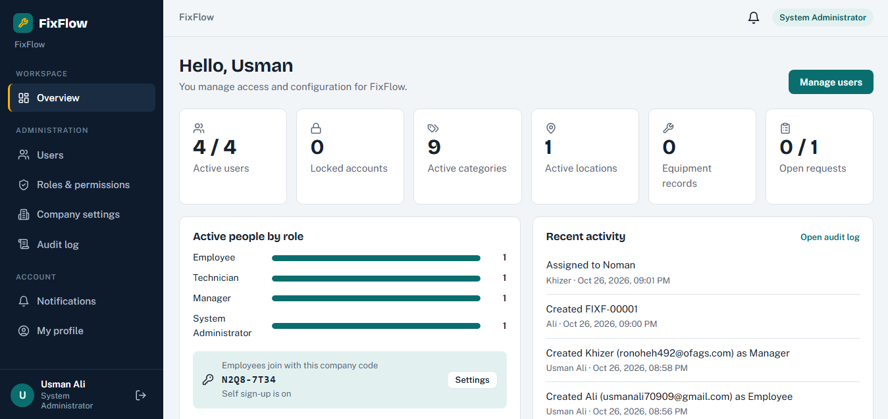
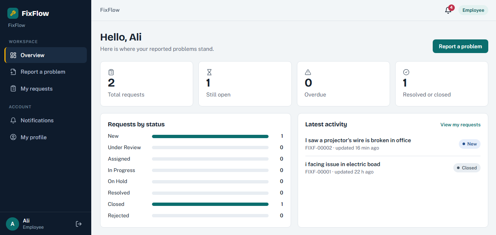
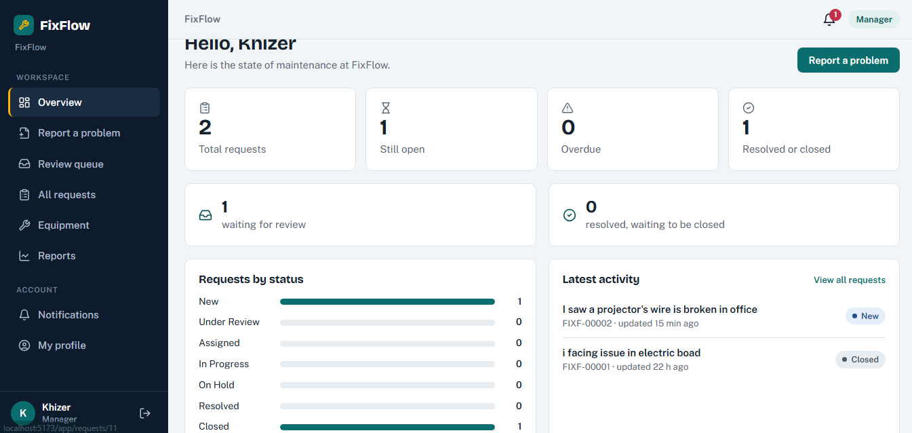
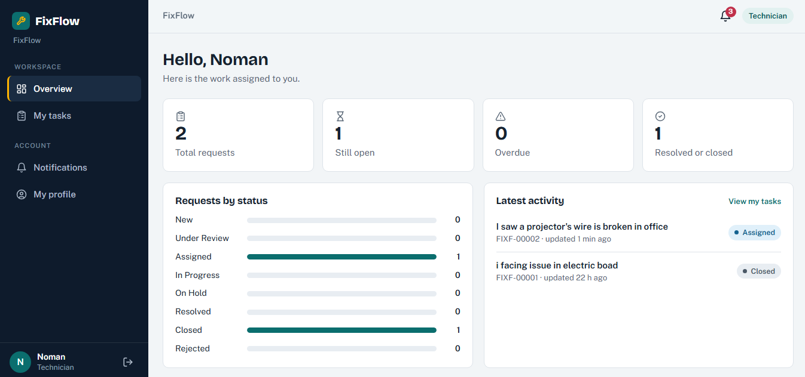
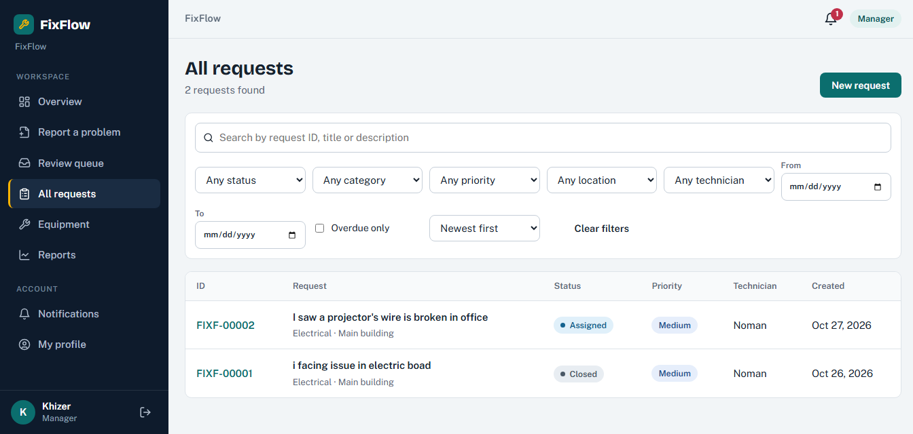
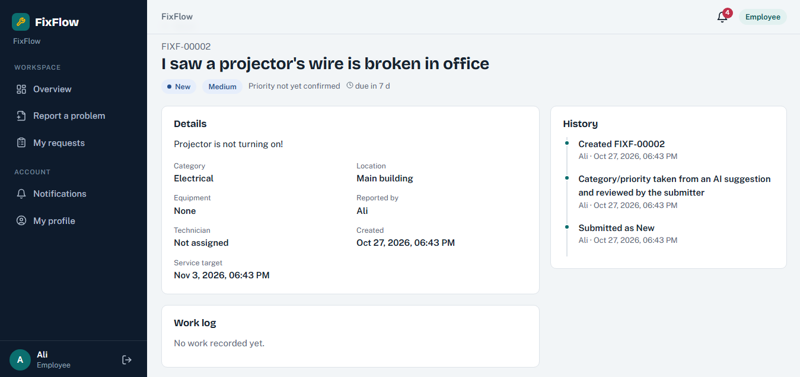
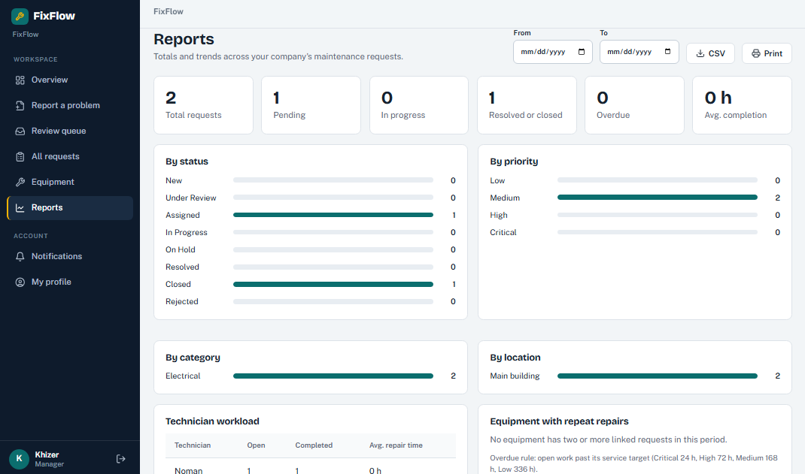
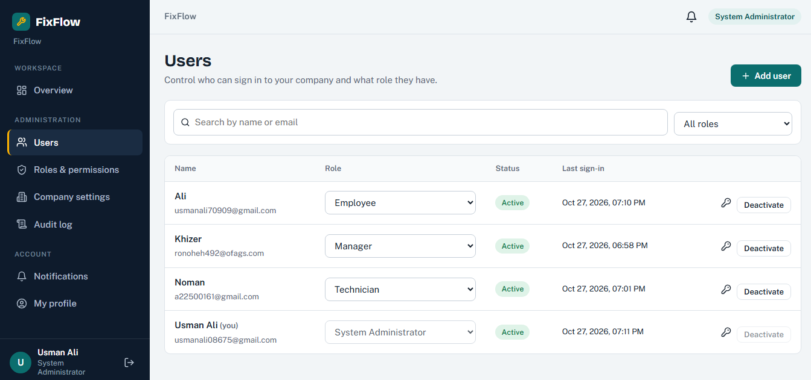
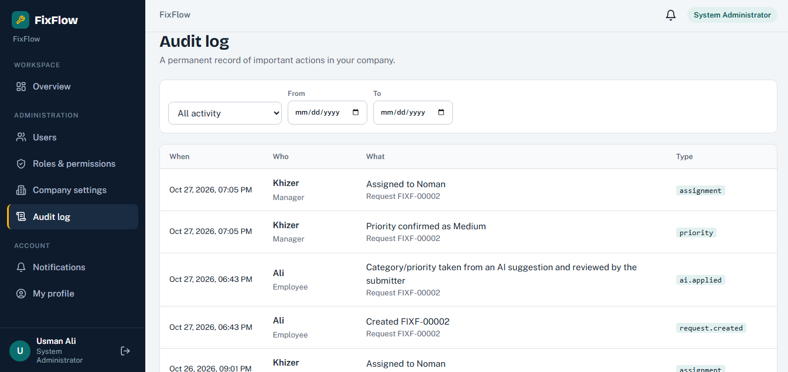

# FixFlow — Maintenance and Repair Management System

FixFlow is a full-stack web application designed to streamline maintenance requests, technician assignments, repair operations, equipment management, and maintenance reporting. It provides a centralized dashboard with role-based access control (RBAC), workflow tracking, notifications, audit history, and AI-assisted suggestions.

## Table of Contents

- [Overview](#overview)
- [Key Features](#key-features)
- [Technology Stack](#technology-stack)
- [System Roles and RBAC](#system-roles-and-rbac)
- [Maintenance Workflow](#maintenance-workflow)
- [Dashboard Screenshots](#dashboard-screenshots)
- [Project Structure](#project-structure)
- [Core Modules](#core-modules)
- [Security and Access Control](#security-and-access-control)
- [Database Management](#database-management)
- [Getting Started](#getting-started)
- [Contributing](#contributing)
- [License](#license)

## Overview

FixFlow centralizes the complete maintenance and repair management process in one application. Employees submit maintenance requests, managers review and assign work, and technicians diagnose issues, record repairs, and submit completion details.

The system maintains request histories, equipment records, work logs, comments, notifications, and audit events to support transparent and accountable maintenance operations.

### Objectives

- Centralize maintenance requests and repair activities.
- Simplify request review, prioritization, and technician assignment.
- Track repair progress from submission to closure.
- Maintain equipment records and associated maintenance histories.
- Enforce permission-based access to application features and data.
- Provide dashboards, reports, and operational insights.
- Improve accountability through activity tracking and audit logs.

## Key Features

### 1. Authentication and User Management

- Secure user authentication and session management.
- Role-based dashboards and navigation.
- User account creation and management.
- Role assignment and password reset.
- Account unlocking and deactivation.
- Server-side authorization for protected operations.

### 2. Maintenance Request Management

- Submit maintenance requests with descriptions, categories, locations, and priority information.
- Generate unique request identifiers.
- Associate requests with equipment records.
- View request details, status, and activity history.
- Search, filter, and sort maintenance requests.
- Review request comments and completion details.

### 3. Request Review and Technician Assignment

- Review incoming maintenance requests.
- Confirm or update request priorities.
- Assign and reassign technicians.
- Record assignment history and responsible users.
- Place requests on hold or reject them with a reason.
- Notify relevant users about important request updates.

### 4. Technician Work Management

- View assigned maintenance tasks.
- Record inspections and diagnoses.
- Add work logs and repair details.
- Record materials and parts used.
- Update work status according to permissions.
- Submit completed work for resolution.
- Maintain repair history and completion information.

### 5. Equipment Management

- Maintain an equipment and facility register.
- Record equipment identifiers, names, categories, locations, and conditions.
- Link equipment to maintenance requests.
- View maintenance history associated with equipment.
- Prevent duplicate equipment identifiers.

### 6. Dashboard and Reporting

- Display maintenance request summaries and status distributions.
- Track pending, in-progress, resolved, and overdue work.
- Analyze requests by category, priority, and location.
- Monitor technician workloads.
- Review repair completion-time metrics.
- Identify equipment with repeated maintenance records.
- Apply role-based access restrictions to reports.

### 7. Comments and Notifications

- Add comments to maintenance requests.
- Record comment authors and timestamps.
- Generate in-app notifications for relevant workflow events.
- Distinguish read and unread notifications.
- Restrict notification visibility to authorized recipients.

### 8. AI-Assisted Suggestions

- Generate category and priority suggestions from maintenance request descriptions.
- Present AI results as recommendations for human review.
- Allow authorized users to review and adjust suggested values.
- Keep request assignment, rejection, resolution, and closure under authorized human control.

### 9. System Administration and Audit Logs

- Manage users and their assigned permissions.
- Configure request categories and organizational locations.
- Manage service targets and company settings.
- Control AI-assisted functionality.
- Maintain an organization join code.
- Review audit logs for accountability and activity tracking.

## Technology Stack

| Component | Technology |
|---|---|
| Frontend | React.js |
| Programming Language | TypeScript |
| Backend | Python |
| API Framework | FastAPI |
| Database | PostgreSQL |
| API Architecture | REST API |
| Data Format | JSON |
| Version Control | Git and GitHub |

## System Roles and RBAC

FixFlow uses Role-Based Access Control (RBAC) to regulate access to system features and data. Backend endpoints enforce permissions, while the application displays role-appropriate navigation and actions.

The permission definitions are maintained in `backend/app/rbac.py` and stored in the `roles`, `permissions`, and `role_permissions` database tables.

| Permission | Employee | Technician | Manager | System Administrator |
|---|---|---|---|---|
| Submit a request | ✓ | — | ✓ | — |
| View requests | Own | Assigned | All | — |
| Add comments | ✓ | ✓ | ✓ | — |
| Review and confirm priority | — | — | ✓ | — |
| Hold or reject requests | — | — | ✓ | — |
| Assign or reassign technicians | — | — | ✓ | — |
| Record diagnoses and work logs | — | Own jobs | Any | — |
| Start and resolve work | — | Own jobs | Any | — |
| Close, send back, or reopen requests | — | — | ✓ | — |
| View equipment register | Read | Read | ✓ | — |
| Edit equipment records | — | — | ✓ | — |
| View reports | — | — | ✓ | — |
| Access AI suggestions | ✓ | — | ✓ | — |
| Manage users and accounts | — | — | — | ✓ |
| Configure company settings | — | — | — | ✓ |
| Manage categories and locations | — | — | — | ✓ |
| Manage service targets and join code | — | — | — | ✓ |
| Control AI settings | — | — | — | ✓ |
| View audit logs | — | — | — | ✓ |

**Note:** A dash indicates that the permission is not granted to that role. All protected operations are validated by the backend.

## Maintenance Workflow

The maintenance lifecycle follows a structured process to ensure that every request is reviewed, assigned, documented, and completed correctly.

1. **Request Submission:** An employee submits a maintenance request with the required information.
2. **Request Review:** A manager reviews the request and confirms its priority.
3. **Technician Assignment:** The manager assigns an eligible technician to the request.
4. **Inspection and Repair:** The technician records the diagnosis, work performed, and repair progress.
5. **Resolution:** The technician submits the repair outcome and required completion details.
6. **Closure:** The manager completes the closure process according to the applicable permissions.
7. **History and Reporting:** The system maintains relevant status changes, assignments, notifications, and maintenance history.

**Request Statuses:** New → Under Review → Assigned → In Progress → Resolved → Closed.

Additional statuses include **On Hold** and **Rejected**.

## Dashboard Screenshots

The following screenshots present the FixFlow dashboard and its role-specific interfaces. Each figure highlights the interface layout, available functionality, and maintenance information displayed to authorized users.

### 1. System Administration

The system administration interface provides authorized administrators with user management, organizational settings, service targets, and system configuration controls. It centralizes administrative operations within a permission-protected interface.

<p align="center">
  
</p>
<p align="center"><strong>Figure 10. System Administration</strong></p>

### 2. Employee Dashboard

The employee dashboard provides access to maintenance request submission, personal request tracking, status updates, and request-related communication. It helps employees follow their reported issues throughout the maintenance lifecycle.

<p align="center">
  
</p>
<p align="center"><strong>Figure 2. FixFlow Employee Dashboard</strong></p>

### 3. Manager Dashboard

The manager dashboard presents the maintenance review queue, request priorities, technician assignments, and operational summaries. It supports request review, workload coordination, and maintenance oversight.

<p align="center">
  
</p>
<p align="center"><strong>Figure 3. FixFlow Manager Dashboard</strong></p>

### 4. Technician Dashboard

The technician dashboard organizes assigned maintenance tasks and provides access to diagnosis, repair documentation, work logs, and status updates. It supports the recording of repair activities and completion details.

<p align="center">
  
</p>
<p align="center"><strong>Figure 4. FixFlow Technician Dashboard</strong></p>

### 5. Maintenance Requests

The maintenance requests interface displays request information, including identifiers, descriptions, priorities, statuses, and assignments. Search and filtering capabilities help authorized users locate and manage relevant requests.

<p align="center">
  
</p>
<p align="center"><strong>Figure 5. Maintenance Request Management</strong></p>

### 6. Request Details and Work Logs

The request details interface presents the maintenance history, diagnosis, work logs, comments, and completion information associated with a request. It provides a consistent record of repair progress and related activities.

<p align="center">
  
</p>
<p align="center"><strong>Figure 6. Request Details and Work Logs</strong></p>

### 7. Reports and Analytics

The reporting dashboard summarizes maintenance activity through status distributions, request categories, priorities, and technician workloads. These insights support operational monitoring and maintenance planning.

<p align="center">
  
</p>
<p align="center"><strong>Figure 8. Reports and Analytics Dashboard</strong></p>

### 8. Roles and Permissions

The roles and permissions interface presents the system's access-control configuration. It supports permission management for employee, technician, manager, and system administrator responsibilities.

<p align="center">
  
</p>
<p align="center"><strong>Figure 9. Roles and Permissions Management</strong></p>

### 9. Notifications and Audit Logs

The notifications interface displays relevant workflow updates, while the audit log records significant system activities for accountability. Together, these features support visibility into maintenance events and administrative actions.

<p align="center">
  
</p>
<p align="center"><strong>Figure 11. Notifications and Audit Logs</strong></p>

## Project Structure

```text
FixFlow/
├── frontend/
│   ├── src/
│   ├── public/
│   └── package.json
├── backend/
│   └── app/
│       └── rbac.py
├── docs/
│   └── images/
│       ├── main-dashboard.png
│       ├── employee-dashboard.png
│       ├── manager-dashboard.png
│       ├── technician-dashboard.png
│       ├── maintenance-requests.png
│       ├── request-details.png
│       ├── equipment-register.png
│       ├── reports-dashboard.png
│       ├── roles-permissions.png
│       ├── system-administration.png
│       └── notifications-audit-logs.png
└── README.md
```

The directory listing identifies the main application components and documentation assets. Frontend and backend implementation files are organized according to their respective responsibilities.

## Core Modules

| Module | Responsibility |
|---|---|
| Authentication | User sign-in, session handling, and access validation |
| User Management | User accounts, roles, password resets, and account status |
| Maintenance Requests | Request creation, review, tracking, and lifecycle management |
| Assignment Management | Technician assignment, reassignment, and assignment history |
| Technician Operations | Diagnosis, work logs, repair progress, and resolution |
| Equipment Management | Equipment records and linked maintenance history |
| Notifications | In-app alerts and read/unread tracking |
| Dashboard and Reports | Maintenance summaries, workload analysis, and operational metrics |
| AI Assistance | Category and priority suggestions |
| RBAC | Permission definitions and server-side authorization |
| Company Settings | Categories, locations, service targets, join code, and AI controls |
| Audit Logging | Records of significant actions and workflow events |

## Security and Access Control

FixFlow applies permission-based authorization throughout its protected operations.

- **Server-Side Authorization:** Backend endpoints validate permissions independently of frontend visibility.
- **Role-Based Navigation:** Users access dashboard features according to their assigned permissions.
- **Input Validation:** Request data is validated before processing and persistence.
- **Controlled Workflow Transitions:** Status changes follow the permissions and rules defined for each role.
- **Data Isolation:** Request details and notifications are restricted to authorized users.
- **Auditability:** Important assignments, status changes, and administrative events are recorded.
- **Credential Protection:** Sensitive credentials and service keys are kept out of frontend code.
- **Safe Error Handling:** Application errors do not expose internal implementation details to users.

## Database Management

FixFlow uses PostgreSQL to maintain structured application data and relationships between system entities.

The database supports:

- User accounts and role permissions.
- Maintenance requests and request status history.
- Technician assignments and reassignment records.
- Equipment and facility records.
- Diagnoses, work logs, and repair completion details.
- Request comments and in-app notifications.
- Audit-relevant activity records.

Relational constraints and backend validation preserve data integrity and ensure that related records reference valid entities.

## Getting Started

### Prerequisites

- Python compatible with the backend's dependency configuration.
- Node.js and npm compatible with the frontend's package configuration.
- PostgreSQL.
- Git.

### 1. Clone the Repository

```bash
git clone https://github.com/Engr-Usman-Ali/FixFlow.git
cd FixFlow
```

### 2. Configure the Backend

Navigate to the backend directory and install the dependencies specified by the project.

```bash
cd backend
```

Configure the required database connection and application settings according to the backend configuration files.

### 3. Configure the Frontend

Open a separate terminal and navigate to the frontend directory.

```bash
cd frontend
npm install
```

Set the frontend API configuration to match the backend configuration used by the application.

### 4. Initialize the Database

Create the PostgreSQL database and configure its connection using the project's supported configuration method. Apply the database initialization or migration procedure provided by the repository.

### 5. Run the Application

Start the backend and frontend using the commands defined in their respective project configuration files. Open the configured frontend address in a supported web browser.

## Contributing

Contributions should follow the existing project structure and coding conventions.

1. Fork the repository.
2. Create a feature branch.
3. Implement and test the changes.
4. Commit the changes with a descriptive message.
5. Open a pull request with a clear summary of the implementation.

## License

Add the project's applicable license information here when the license has been established.

---

**Repository:** [Engr-Usman-Ali/FixFlow](https://github.com/Engr-Usman-Ali/FixFlow)

**Project:** FixFlow — Maintenance and Repair Management System
